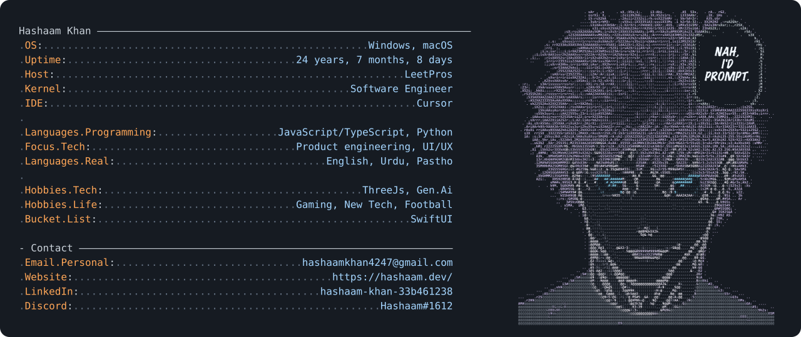
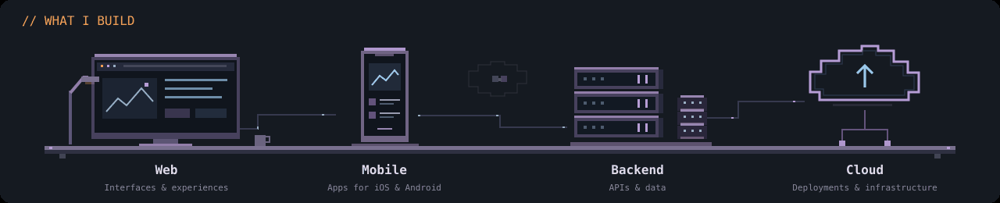

<a href="https://github.com/HashaamKhan19/HashaamKhan19">
  <picture>
    <source media="(prefers-color-scheme: dark)" srcset="./dark_mode.svg">
    
  </picture>
</a>
 

<picture>
  <source media="(prefers-reduced-motion: reduce)" srcset="./assets/what-i-build-static.png">
  
</picture>
